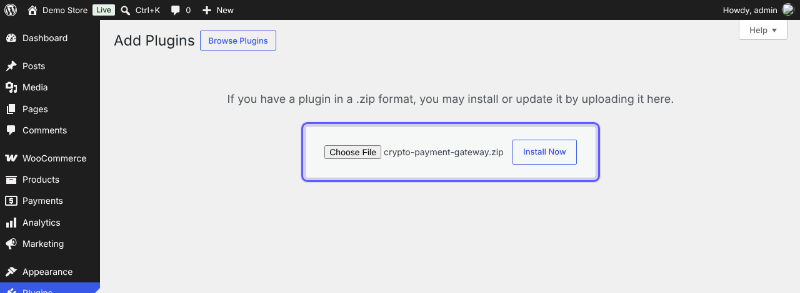
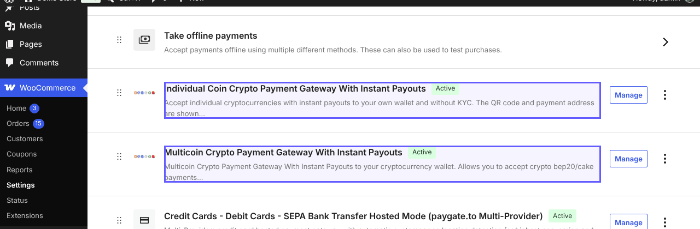
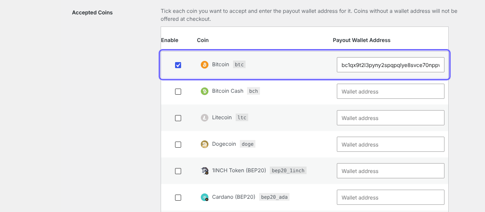
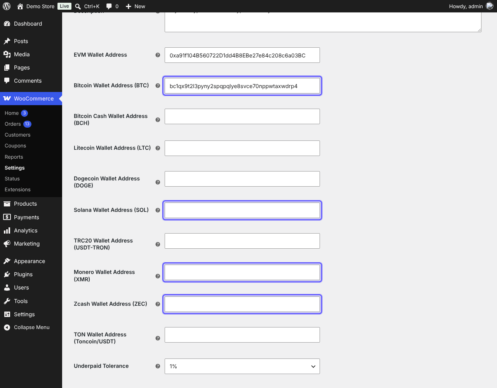
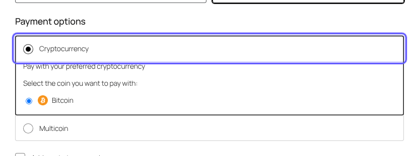
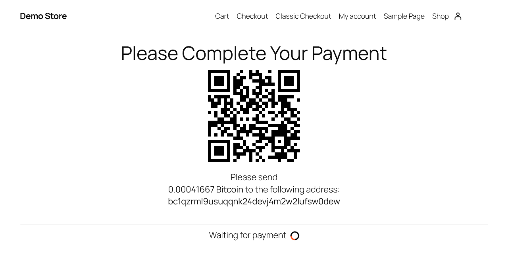
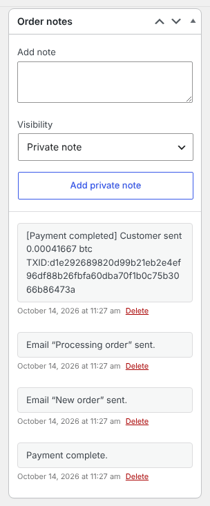

# WooCommerce-Crypto-Payment-Gateway
Cryptocurrency Payment Gateway with instant payouts to your wallet and without KYC hosted directly on your website.

> **The only crypto payment gateway with instant payouts for Solana (SOL), Monero (XMR), Zcash (ZEC) and Bitcoin (BTC).**
> Every payment is forwarded straight to your own wallet the moment it is confirmed: no holds, no sign up, no KYC. The same support is built into all our plugins and modules: WooCommerce, WHMCS, OpenCart, PrestaShop and Magento.

## Features

- Accept **Bitcoin, Solana, Monero, Zcash, ETH, USDT, USDC** and hundreds of other coins and tokens on BTC, BCH, LTC, DOGE, ETH, ERC20, BEP20, Polygon, Arbitrum, Base, Optimism, Avalanche-C, Solana, Tron (TRC20), TON and more ([full list and minimums](https://paygate.to/crypto-payment-gateway-no-kyc-instant-payouts/#minimumorder)).
- **Instant payouts**: crypto is forwarded to your wallet the moment the payment is confirmed, with no delay or holds.
- **No KYC and no registration**: you and your customers stay anonymous.
- **QR code on your own site** with a unique address for every order, or one **Multicoin** option where the customer picks any coin on the hosted page.
- Payment confirmations signed by PayGate.to and verified by the module: orders are marked paid by themselves.
- Choose who pays the blockchain fee: you or the customer.
- If a customer sends the wrong token or uses the wrong network, supported tokens are still forwarded to you automatically.
- Works with your own checkout domain and a free dedicated API endpoint ([custom domain guide](https://paygate.to/white-label-api-custom-domain-guide/)).
- Fees: **1.5% flat rate + blockchain fees**.

📘 **Step-by-step guide with screenshots:** [https://paygate.to/crypto-payment-gateway-no-kyc-instant-payouts/woocommerce/](https://paygate.to/crypto-payment-gateway-no-kyc-instant-payouts/woocommerce/)

## Requirements

- WordPress 5.8+ and **WooCommerce 5.8+**, PHP 7.2+ with OpenSSL
- A public website that can make outbound HTTPS requests (the coin list is loaded live)
- WordPress installed at the domain root (not in a subfolder) with Permalinks set to anything except "Plain" (the live payment status on the QR page uses `/wp-json/`)
- A wallet address for each coin you want to accept

## Installation

1. **Prepare your wallets.** Crypto is forwarded to **your own wallet addresses**, one per coin or network: a Bitcoin address for BTC, a Solana address for SOL and Solana tokens, Monero and Zcash addresses for XMR and ZEC, and one `0x` address for ETH and all EVM networks (ERC20, BEP20, Polygon, Arbitrum, Base, Optimism, Avalanche-C). Use **self-custodial wallets** you control and **never exchange deposit addresses**.
2. **Install the plugin.** In WordPress open **Plugins › Add Plugin** ("Add New Plugin" in some versions), search for **Crypto Payment Gateway with Instant Payouts** and click **Install Now**, or download it from [WordPress.org](https://wordpress.org/plugins/crypto-payment-gateway/) / this repository and use **Upload Plugin**. Then **Activate** it.

   

3. Open **WooCommerce › Settings › Payments**. Two methods are added: **Individual Coin Crypto Payment Gateway With Instant Payouts** (QR code on your site) and **Multicoin Crypto Payment Gateway With Instant Payouts** (hosted page, all coins).

   

4. **Individual coins**: click **Manage**, tick **Enable**, then in **Accepted Coins** tick each coin you want and paste its payout wallet. A coin needs both the tick and a wallet. Save.

   

5. **Multicoin (optional)**: tick **Enable** and fill in one wallet per network: EVM, Bitcoin (BTC), Bitcoin Cash, Litecoin, Dogecoin, **Solana (SOL)**, TRC20, **Monero (XMR)**, **Zcash (ZEC)** and TON. Save.

   

6. **Test**: the customer picks a coin at checkout and sees the QR code, the exact amount and a unique address on your own website.

   

   

7. When the payment is confirmed the crypto is forwarded to your wallet and the order moves to **Processing**, with the amount and TXID in the order notes.

   

## Settings

| Setting | Description | Default |
|---|---|---|
| Accepted Coins (individual coins) | Tick a coin and enter its payout wallet. The list is loaded live from PayGate.to. | none |
| Wallet fields (Multicoin) | EVM, BTC, BCH, LTC, DOGE, SOL, TRC20, XMR, ZEC, TON. At least one is required. | empty |
| Custom API Domain | Your free dedicated API endpoint or white-label domain. | api.paygate.to |
| Custom Domain (Multicoin) | Domain of the hosted checkout page. | checkout.paygate.sbs |
| Underpaid Tolerance | Accept payments slightly below the total (0–10%). | 1% |
| Customer Pays Blockchain Fees | Add the estimated network fee to the amount the customer sends. | off |
| Custom Logo URL, colours (Multicoin) | Branding of the hosted page. | empty |

## Order statuses

- **Pending payment**: waiting for the crypto payment.
- **Processing** (or Completed for virtual/downloadable orders): the full amount was received.
- **Failed**: less than the required amount was received; a note shows the amounts.

## Troubleshooting

- **The method does not show at checkout**: at least one coin needs both the tick and a wallet (Multicoin: one wallet).
- **"Could not fetch the coin list"**: allow outbound HTTPS from your server to `api.paygate.to`.
- **"Error checking payment status" on the QR page**: set **Settings › Permalinks** to anything except "Plain"; the live status also needs WordPress at the domain root, not in a subfolder.
- **Order stays Pending after payment**: make sure nothing blocks or caches `/wp-json/`. See [WooCommerce troubleshooting](https://paygate.to/woocommerce-payment-gateway-troubleshooting/).

Full product page: [https://paygate.to/crypto-payment-gateway-no-kyc-instant-payouts/](https://paygate.to/crypto-payment-gateway-no-kyc-instant-payouts/) · Support: [Telegram](https://t.me/PayGate_to)
